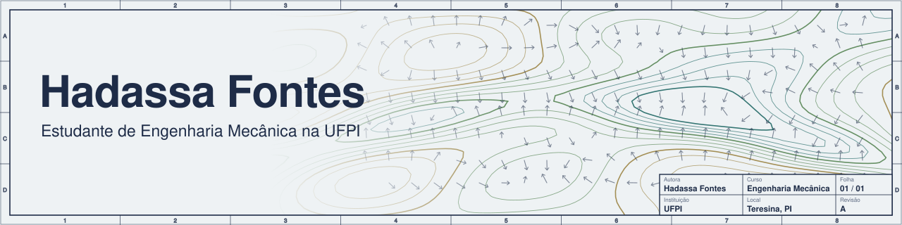

<picture>
  <source media="(prefers-color-scheme: dark)" srcset="banner-dark.svg">
  
</picture>

Estudante de Engenharia Mecânica na UFPI, em Teresina.
Aqui estão os projetos que desenvolvi na graduação. Se algum deles tiver a ver com o que você procura, me chama.

### Atividades

- **Pesquisa no PRH 59/ANP (UFPI):** visão computacional aplicada ao monitoramento de taludes, com Python e OpenCV.
- **Bull Racing:** marketing e comunicação na equipe de Fórmula SAE da UFPI.
- **Projeto Faísca:** extensão da Engenharia Mecânica voltada para mulheres.

### Projetos

<table>
  <tr>
    <td width="50%" valign="top">
      
      
<b>Visualizador Topográfico 3D</b> 
      Terreno de Teresina em 3D, para explorar no navegador ou no celular.

      <a href="https://hadassita.github.io/projetocartografiav2/">Ver online</a> ·
      <a href="https://github.com/Hadassita/projetocartografiav2">Código</a>
    </td>
    <td width="50%" valign="top">
      
      
<b>Malha Urbana 3D (v1)</b> 
      Primeira versão do projeto, com a malha urbana da cidade.

      <a href="https://hadassita.github.io/projetocartografia/">Ver online</a> ·
      <a href="https://github.com/Hadassita/projetocartografia">Código</a>
    </td>
  </tr>
</table>

### Ferramentas (nível básico)

Python, OpenCV, JavaScript, C++, HTML e LaTeX.
Design: Canva e Photoshop.

### Contato

[hadassafontes12@gmail.com](mailto:hadassafontes12@gmail.com)
